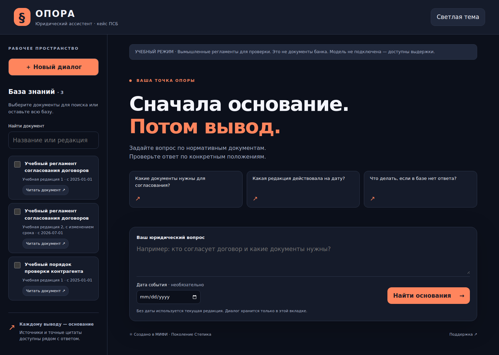

# ОПОРА · юридический ассистент по документам

**Вопрос → нужная редакция документа → ответ с проверяемыми основаниями.**

ОПОРА помогает сотруднику найти положения договора или закона, проверить предпосылку
вопроса и продолжить диалог с уточнениями. Ответ ограничен загруженной базой знаний.
Проект подготовлен под кейс ПСБ; внешнего поиска и юридических ответов «по памяти» нет.

> Состояние: программный MVP с импортом предоставленного корпуса и официальным CSV-контрактом.
> Без доступа к модели работают поиск и просмотр первоисточников. Живой API, юридическое
> качество и оценка платформы ещё требуют проверки. Скриншот выше сделан на учебной базе.

## Быстрый запуск

**Windows:** распакуйте всю папку проекта и откройте **START_PSB.cmd**.
Нужен установленный Python 3.10+. Скрипт создаст шаблон .env, найдёт свободный порт
начиная с 8080 и откроет сайт. Остановка — Ctrl+C в окне запуска.

**Linux / macOS:**

~~~bash
python3 -m psb.launcher
~~~

Node.js, сборка фронтенда и установка Python-пакетов для работы сайта не нужны.
Если Python не найден, установите его или задайте PSB_PYTHON полным путём к интерпретатору.

~~~powershell
.\START_PSB.cmd --check
.\START_PSB.cmd --port 8090 --no-browser
~~~

Проверка --check проверяет настройки и корпус; запросы к модели не выполняются.

## Подключение предоставленных документов

Поместите исходный архив knowledge-base.zip в папку data рядом с проектом.
Затем запустите:

~~~bash
python scripts/prepare_data.py data/knowledge-base.zip
~~~

Будет создан data/knowledge.json с явной отметкой corpus_kind=provided.
Поддерживаются TXT, MD и DOCX внутри ZIP. Для корпуса из кейса распознаются даты,
пункты, две редакции регламента, договоры и связь с допсоглашением. Оригинальные
тексты и SHA-256 сохраняются. Неизвестные структуры требуют явного манифеста,
описанного в [инструкции по корпусу](docs/corpus.md).

Запуск автоматически выбирает data/knowledge.json, затем доступный архив из data.
Если данных нет — открывается явно помеченная синтетическая база из трёх документов.
Явный PSB_CORPUS_PATH, PSB_CORPUS_ZIP или PSB_CORPUS_FILE имеет приоритет.
При старом .env с путём samples/psb-demo.json очистите этот параметр или укажите новую базу.

Исходные документы, вопросы, ответы и рабочий .env не публикуются в Git.

## Подключение модели

Заполните .env, созданный при первом запуске:

~~~dotenv
LLM_BASE_URL=https://адрес-от-организаторов/v1
LLM_API_KEY=ключ-от-организаторов
LLM_MODEL=deepseek/deepseek-v4.1-flash
~~~

Адрес выше — пример, его нужно заменить. Имя модели взято из предоставленного
организаторского стартера. При необходимости используйте PSB_LLM_BASE_URL,
PSB_LLM_API_KEY, PSB_LLM_MODEL — эти имена имеют приоритет.

Генерация и отдельная смысловая проверка используют одну настроенную модель.
Неверный ID источника, недословная цитата или отклонённый проверяющим ответ
не превращаются в юридический вывод. Одна и та же модель может ошибаться на обоих этапах,
поэтому автопроверка не заменяет оценку специалистом.

Для семантического ранжирования:

| Параметр | Значение по умолчанию в шаблоне |
|---|---|
| EMB_MODEL | baai/bge-m3 |
| RERANKER_MODEL | cohere/rerank-5-fast |
| PSB_USE_EMBEDDINGS / PSB_USE_RERANKER | true / true |
| TOP_K | 40 локальных кандидатов |
| RERANKER_TOP_N | 12 положений |
| MAX_WORKERS | 2 независимых CSV-кейса |
| MAX_TOKENS | 3500 на обращение генерации/проверки |
| PSB_LLM_TIMEOUT_SECONDS | 35 секунд на API-запрос |

Ключи EMBEDDER_API_KEY и RERANKER_API_KEY можно задать отдельно; иначе используется
ключ генерации. При ошибке дополнительных сервисов сохраняется предыдущее ранжирование,
причина видна в трассировке. Дополнительные модели можно отключить значением false.
Для платформенных имён URL эти сервисы включены по умолчанию; для прежней конфигурации
только PSB_* — включаются явно. Наличие настроек не означает, что доступ уже проверен.

## Что умеет MVP

| Возможность | Поведение |
|---|---|
| Поиск по всей базе или выбранным документам | Локальное BM25-подобное ранжирование; при API — embeddings и rerank |
| Исторические редакции | Интервалы действия; месяц принимается только при неизменной редакции |
| Похожие контрагенты | Номер договора и последнее уточнение определяют область поиска |
| Допсоглашения | В контексте остаются исходный договор, изменение и условие применимости |
| Законы | Дата выгрузки не выдаётся за дату принятия; отсутствующая история не выдумывается |
| Обоснование | Каждый модельный вывод содержит дословную цитату и существующий ID |
| Недостаточно данных | Модель должна объяснить пробел, дать частичный ответ или запросить уточнение |
| Защита контекста | Документы и история недоверенные; явная инструкция для ИИ в записке не индексируется |
| Интерфейс | Источники, дата, светлая/тёмная тема, мобильный экран, JSON-экспорт, отмена ожидания |
| Платформа | questions.csv → submission.csv; независимые кейсы, порядок и строковые ID сохраняются |

Отмена ожидания в браузере не гарантирует отмену уже начатого запроса API.
Диалог хранится только в текущей вкладке.

## Запуск на платформе

Структура входа из предоставленного sample_submission.zip:

~~~text
data/
  questions.csv       # id,question
  kb.zip              # также knowledge-base.zip или knowledge_base.zip
solution.py
psb/
requirements.txt
~~~

~~~bash
python solution.py
~~~

Платформа передаёт DATA_DIR, URL, ключи и имена моделей через окружение.
Результат — submission.csv с колонками id,answer. Все поля в кавычках,
каждому входному ID соответствует одна физическая строка. Вопрос может содержать
диалог вида «Пользователь: … / Ассистент: … / Пользователь: …».

Локальный прогон примеров без платного API:

~~~bash
python solution.py --questions data/demo_questions.csv --corpus data/knowledge-base.zip --offline --output artifacts/offline.csv --report artifacts/offline.json
~~~

Результат --offline — явно подписанные выдержки, а не готовые модельные ответы.
demo_output.csv — эталоны для оценки; решение не читает их и не копирует готовые ответы.

Сборка:

~~~bash
python scripts/package_submission.py
~~~

Получится artifacts/PSB_submission.zip. В нём только исполняемый код, статика и
requirements.txt; .env, база и эталоны исключены списком разрешённых файлов.
Такой же ZIP доступен в артефакте PSB-submission каждого успешного CI.
Локальный прежний API сохранён отдельным режимом:

~~~bash
python solution.py --jsonl
~~~

## Архитектура и технологии

Python 3.10+ и стандартная библиотека: HTTP-сервис, urllib API-клиент, CSV, JSON,
XML/DOCX, ZIP и поиск в памяти. Браузер — HTML/CSS/JavaScript без CDN и сборщика.
Playwright нужен только тестам; pypdf — дополнительному импорту PDF.
Предоставленный общий requirements.txt изучен; весь перечень библиотек не требуется
этому решению. Runtime-зависимости не добавляются без необходимости.

~~~mermaid
flowchart TD
  I["ZIP или JSON корпуса"] --> K["Пункты, редакции, индекс"]
  Q["Вопрос и история"] --> R["Область и ранжирование"]
  K --> R
  R --> G["Генерация с цитатами"]
  G --> V["Точные цитаты и смысловая проверка"]
  V --> O["Чат или CSV"]
~~~

| Путь | Назначение |
|---|---|
| psb/corpus.py | Безопасное чтение ZIP, пункты, даты, связь допсоглашений |
| psb/knowledge.py | Корпус, интервалы редакций, локальный поиск, контрагенты |
| psb/retrieval.py | Дополнительное API-ранжирование и fallback |
| psb/assistant.py | Запрос, генерация, проверка цитат и отдельный проверяющий |
| psb/submission.py, solution.py | Диалоги и официальный CSV-контракт |
| psb/config.py, psb/launcher.py | Настройки и быстрый запуск |
| psb/server.py, psb/static/ | HTTP API и интерфейс |
| scripts/ | Импорт, оценка поиска, сборка ZIP |
| tests_psb/, tests_browser/, tests_import/ | Автоматические проверки |
| docs/ | API, корпус, тестирование, передача и сдача |

## Проверки и качество

~~~bash
python -m unittest discover -s tests_psb -v
node --check psb/static/chat.js
python -m psb.launcher --check
~~~

CI проверяет Python 3.10/3.12/3.14 на Linux, настоящий CMD-запуск на Windows,
Chromium desktop/mobile, Docker, импорт PDF и сборку платформенного ZIP.
Подробности и границы результатов — в [TESTING.md](docs/TESTING.md).

На предоставленном корпусе выполнен первичный локальный прогон 18 демонстрационных
вопросов. Полный набор вручную размеченных оснований найден для 16 из 17 положительных
вопросов в первых 12 результатах; один вопрос относится к отсутствующим в базе сведениям.
Это предварительный результат до последующих исправлений морфологии и названий.
Он не является точностью юридических ответов, оценкой отказов или скором платформы.
Для воспроизводимого замера используйте scripts/evaluate.py с собственной разметкой.
Живой API в переданных материалах отсутствует, поэтому модельное качество не измерено.

## Docker

~~~bash
docker compose up --build -d --wait
~~~

Для реального корпуса задайте PSB_CORPUS_FILE=./data/knowledge.json в .env.
Сервис публикуется на 127.0.0.1:8080; контейнер работает непривилегированно,
с файловой системой только для чтения и ограниченными ресурсами.

## Следующий шаг

Для приёмки модельного MVP нужны рабочий адрес и ключ API, полный прогон вопросов
с сопоставлением demo_output.csv и проверка результата на платформе.
Точные ограничения времени и памяти ещё нужно подтвердить у организаторов.

[План передачи](docs/HANDOFF.md) · [API](docs/API.md) ·
[Корпус](docs/corpus.md) · [Сдача](docs/delivery.md) · [Изменения](CHANGELOG.md)

Создано в МИФИ · команда «Поколение Степика» ·
[поддержка](https://t.me/m_petukhov_2008)
