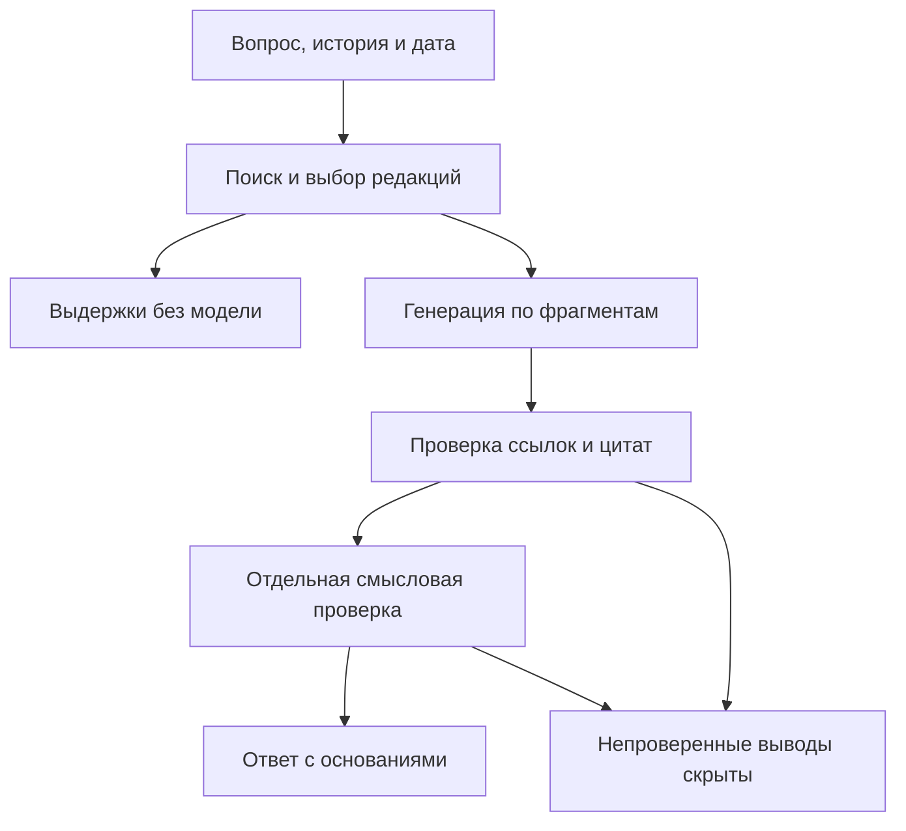

<div align="center">

# § ОПОРА

### Юридический ассистент по закрытой базе документов

**Найти положение → проверить редакцию → увидеть основание вывода**

[](https://github.com/mpetukhov2008/PSB/actions)

[Быстрый старт](#быстрый-старт) · [Возможности](#что-умеет-опора) · [Архитектура](#как-устроен-проект) · [Передача команде](docs/HANDOFF.md)

</div>


> **Версия 1.1.0 · рабочий прототип для передачи в разработку.** По умолчанию используются вымышленные учебные документы, модель отключена. Интерфейс и поиск работают без API-ключей; результатом будут найденные выдержки. База организаторов, их API и официальный формат сабмита ещё не подключены.

## Быстрый старт

### Windows — один файл

1. Скачайте [ZIP проекта](https://github.com/mpetukhov2008/PSB/archive/refs/heads/main.zip) и **распакуйте всю папку**.
2. Убедитесь, что установлен **Python 3.10 или новее**. Если Python отсутствует, установите его с [python.org](https://www.python.org/downloads/).
3. Дважды нажмите **`START_PSB.cmd`**.

Запуск найдёт Python, прочитает `.env`, проверит базу, подберёт свободный порт и откроет сайт в браузере. Ни Docker, ни установка pip-пакетов для этого режима не нужны. Оставьте окно запуска открытым; для остановки нажмите **Ctrl+C**. Если браузер не открылся, скопируйте адрес из окна.

Обычный адрес — **http://127.0.0.1:8080/**. Если порт занят, программа последовательно проверит следующие 19 портов и выведет выбранный адрес. Повторный запуск создаёт отдельный процесс; старый экземпляр нужно остановить в его окне.

<details>
<summary>Если Python не находится или нужно проверить настройки</summary>

В PowerShell из папки проекта:

```powershell
# Только если автоматический поиск не нашёл установленный Python:
$env:PSB_PYTHON = 'C:\полный\путь\к\python.exe'
.\START_PSB.cmd

# Проверка без запуска сервера и без обращения к модели:
.\START_PSB.cmd --check

# Другой начальный порт, без автоматического открытия браузера:
.\START_PSB.cmd --port 8090 --no-browser
```

Поддерживаются Python Launcher (`py -3`), Python из PATH, стандартные каталоги установки и MSYS2 UCRT64. Псевдонимы Microsoft Store пропускаются. Нужна вся распакованная папка, а не отдельно скопированный CMD-файл.

</details>

### Linux / macOS

Из папки проекта:

```bash
python3 -m psb.launcher
```

### Docker — одна команда

```bash
docker compose up --build -d --wait
```

Адрес: http://localhost:8080. Остановка: `docker compose down`. Нужны Docker Engine / Docker Desktop и Docker Compose v2. Порт опубликован только на локальном компьютере. В отличие от обычного запуска, Docker использует фиксированный порт 8080.

## Что умеет ОПОРА

| Возможность | Как это работает |
|---|---|
| Поиск по закрытой базе | Локальное ранжирование фрагментов; внешний поиск не используется |
| Редакции на дату события | Для документов компании выбирается интервал действия редакции; неизвестные периоды не подменяются текущей нормой |
| Проверяемые основания | Каждый модельный вывод содержит ID существующего фрагмента и точную цитату |
| Два этапа проверки | Сначала проверяются ссылки и цитаты, затем отдельный запрос к той же модели оценивает обоснованность ответа |
| Явные ограничения | Недостаток данных, уточнение, частичный ответ и отказ предусмотрены в контракте |
| Работа с источником | Из результата открывается текст документа с положениями и выделенной цитатой |
| Удобный чат | Фильтр документов, короткая история, светлая/тёмная тема, адаптация к телефону |
| Контроль результата | JSON-выгрузка ответа с источниками, датой, отпечатком корпуса и этапами обработки |
| Быстрая проверка | Учебная база, диагностический запуск, модульные и браузерные тесты, Docker CI |

Прекращение ожидания отменяет запрос в браузере. Уже начатая модельная обработка на сервере может завершиться отдельно; в интерфейсе это обозначено явно. «Новый диалог» очищает историю и не принимает запоздавший ответ от предыдущего запроса.

## Попробовать за три минуты

1. **Найти основания:** «Какие документы нужны для согласования договора?» Откройте найденные положения и полный текст.
2. **Проверить дату:** «Какой срок согласования договора на 2026-03-01?» В учебном документе будет найдено **пять рабочих дней**.
3. **Сменить редакцию:** начните новый диалог и спросите тот же вопрос на **2026-07-01** — найдётся **три рабочих дня**. Если дата в вопросе противоречит полю даты, приложение попросит её уточнить.
4. **Проверить нехватку сведений:** задайте вопрос о ставке НДС. В учебном корпусе оснований для него нет.
5. **Сохранить результат:** нажмите «Скачать результат · JSON».

Сроки, названия и положения в учебной базе вымышлены. Эти примеры проверяют работу программы и не являются правовыми рекомендациями.

## Подключить предоставленную базу и модель

Создайте `.env` рядом с `START_PSB.cmd`, скопировав `.env.example`. Все Python-точки входа читают этот файл; значения окружения процесса имеют приоритет.

| Переменная | Для чего нужна | Значение по умолчанию |
|---|---|---|
| `PSB_CORPUS_FILE` | Путь к подготовленному JSON; также используется Compose для подключения файла | `./samples/psb-demo.json` |
| `PSB_CORPUS_PATH` | Необязательное переопределение пути для Python и `solution.py` | не задано |
| `PSB_LLM_BASE_URL` | Базовый адрес OpenAI-совместимого API, например с окончанием `/v1` | не задано |
| `PSB_LLM_MODEL` | Точный идентификатор модели из регламента организаторов | не задано |
| `PSB_LLM_API_KEY` | Ключ настроенного API | не задано |
| `PSB_LLM_TIMEOUT_SECONDS` | Таймаут одного модельного запроса, от 1 до 120 секунд | `35` |

Относительные пути для Python разрешаются от **корня проекта**, независимо от текущей папки терминала. В `.env` используйте буквальные значения: без `export`, подстановок `${...}` и комментариев в конце строки. Комментарии размещайте отдельными строками. Не включайте рабочий `.env` в архив для передачи.

В ТЗ указана **DeepSeek V4.1 Flash**. Конкретные URL, способ авторизации, идентификатор модели и ограничения необходимо сверить с техническим регламентом. Код использует совместимый с `chat/completions` HTTP-адаптер; в репозитории нет предустановленного адреса или выдуманного идентификатора модели. Генерация и проверка используют одну настроенную модель, без автоматического переключения провайдера.

При включённой модели на заданный API передаются вопрос, короткая история и найденные фрагменты. При двух модельных этапах ожидание может составлять до двух настроенных таймаутов плюс время обработки. Ошибки API и непрошедшие проверку выводы не превращаются в юридический ответ. Показатель «модель настроена» означает наличие конфигурации; реальный доступ проверяется при запросе.

Подготовка TXT, MD, DOCX и PDF описана в **[формате корпуса](docs/corpus.md)**. Веб-приложение не устанавливает зависимости; только для необязательного локального импорта PDF нужен `requirements-import.txt`.

## Как устроен проект



| Путь | Назначение |
|---|---|
| `START_PSB.cmd` | Один файл запуска для Windows |
| `psb/launcher.py`, `psb/config.py` | Диагностика, `.env`, выбор порта и открытие браузера |
| `psb/knowledge.py` | Корпус, фрагменты, локальный поиск, интервалы редакций |
| `psb/assistant.py` | Контекст, генерация, точные цитаты и смысловая проверка |
| `psb/server.py`, `psb/static/` | HTTP API и интерфейс без внешних CDN |
| `solution.py` | Независимые JSONL-кейсы на том же ядре |
| `scripts/import_corpus.py` | Локальная подготовка предоставленных документов |
| `tests_psb/`, `tests_browser/` | Регрессии ядра, HTTP, API-адаптера, запуска и интерфейса |
| `docs/` | Контракт API, проверка, передача команде и состав сдачи |

Сервер не хранит историю диалогов. История явно передаётся клиентом и хранится только в памяти вкладки. База подключается при старте; изменение корпуса требует перезапуска. Ключи не отдаются браузеру и не входят в JSON-выгрузку результата.

## Тесты и воспроизводимость

```bash
python -m unittest discover -s tests_psb -v
node --check psb/static/chat.js
python -m psb.launcher --check
```

Node.js нужен только для проверки синтаксиса JS. Для браузерных тестов:

```bash
python -m pip install -r requirements-dev.txt
python -m playwright install chromium
python tests_browser/check_ui.py
```

GitHub Actions проверяет ядро на Python **3.10 / 3.12 / 3.14**, реальный CMD-запуск на **Windows**, Chromium и **Docker Compose**. В Linux две проверки CMD отмечаются как пропущенные; они выполняются в Windows job. Снимки интерфейса сохраняются в артефакт `psb-interface` соответствующего запуска.

**[Подробная проверка и границы тестов](docs/TESTING.md)** · **[CI на GitHub](https://github.com/mpetukhov2008/PSB/actions)**

## Следующей команде разработки

Начните с **[HANDOFF.md](docs/HANDOFF.md)**: там есть приоритеты, точки входа, критерии готовности и порядок продолжения работы. Контракт HTTP/JSONL — в **[API.md](docs/API.md)**, требования к окончательной сдаче — в **[delivery.md](docs/delivery.md)**.

Главные незакрытые пункты:

- **P0:** получить базу и регламент организаторов; подключить настоящий API; привести `solution.py` к официальному формату; провести оценку ответов на предоставленных вопросах.
- **P1:** измерить полноту поиска, качество отказов и задержку; по результатам добавить эмбеддинги/реранкинг и расширить обработку редакций и допсоглашений.
- **Перед финальной сдачей:** подготовить PDF-презентацию и проверенный ZIP для платформы. Готовый прототип не заменяет эти материалы.
- **Перед общим размещением:** добавить аутентификацию, TLS, ограничения входящего трафика и согласованный режим хранения данных. Сейчас это локальное рабочее пространство.

Качество юридических ответов с настоящей DeepSeek и скор LLM-судьи **не измерены**. Точное совпадение цитаты и успешная модельная проверка не гарантируют юридическую правильность. Полный список ограничений и проверяемых задач находится в документе передачи.

---

Создано в МИФИ · [Поддержка](https://t.me/m_petukhov_2008) · [Изменения версии](CHANGELOG.md)
